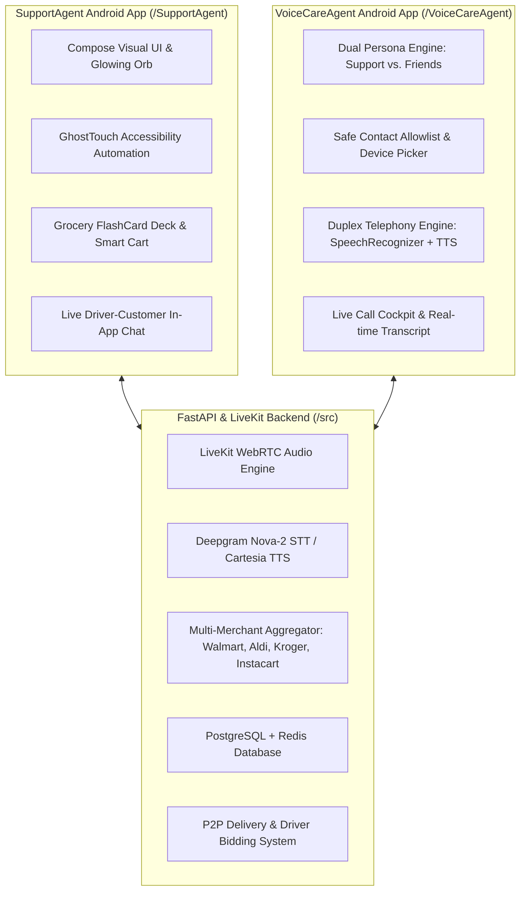
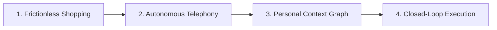

# 📋 Project Agenda, Architecture & Future Roadmap
**Project:** Baskt / Next-Gen Autonomous Voice & Grocery Assistant  
**Repository:** [github.com/Sree8778/Baskt](https://github.com/Sree8778/Baskt)  
**Date:** November 2026  

---

## 1. Executive Summary & Vision

Modern consumers face daily friction across two primary communication and logistics touchpoints:
1. **Grocery & Errand Friction:** Navigating crowded e-commerce apps, cross-referencing multi-retailer inventory (Walmart, Aldi, Kroger), managing dietary restrictions, and coordinating delivery.
2. **Phone Call & Telephony Friction:** Waiting on hold with customer support lines, navigating robotic IVR ("Press 1 for Billing...") phone trees, and spending time on routine coordination calls (scheduling appointments, dinner plans, or checking on friends).

### The "Invisible Assistant" Mission
**Baskt** is built to bridge these workflows into a unified, autonomous ecosystem:
- An **AI-powered voice shopping companion** that handles product discovery, visual card browsing, cart staging, and delivery coordination.
- An **autonomous telephony agent (`VoiceCareAgent`)** that places real cellular phone calls on your behalf—capable of negotiating with customer service representatives or coordinating personal plans with friends using natural, duplex turn-taking conversation.

---

## 2. System Architecture & Components

The Baskt ecosystem is composed of three interconnected modules:

---

## 3. What Has Been Built (Live & Tested)

### A. VoiceCareAgent (Autonomous Telephony)
- **Real Cellular Telephony (`Intent.ACTION_CALL`):** Dials real phone numbers over the device's carrier network (tested on Google Pixel 9).
- **Dual-Mode Calling:**
  - **🏢 Customer Care Mode:** Handles automated phone menus, order disputes, flight cancellations, internet outages, and returns with enterprise context.
  - **🤝 Friend / Personal Calling Mode:** Calls friends or acquaintances to schedule events (e.g., Saturday dinner, tutoring sessions, gym workouts) with customizable conversational agendas.
- **🛡️ Safe Allowlist Contact Sandbox:**
  - Strict privacy protections to prevent accidental calls to random address book contacts.
  - Interactive multi-select contact picker with real-time name/phone search.
  - Dynamic allowlist management with instant removal cards.
- **🎙️ Conversational Duplex Turn-Taking Engine:**
  - Replaced rigid pre-timed scripts with a dynamic conversational state machine:
    1. Agent speaks initial greeting and clarifies caller identity.
    2. Agent stops speaking immediately (`UtteranceProgressListener.onDone`).
    3. Engine switches to `LISTENING` mode via Android `SpeechRecognizer`.
    4. Upon detecting callee speech, generates contextual responses via `VoiceAgentConversationEngine`.
    5. Returns to listening until call goal is resolved.
- **Live Cockpit UI:** Real-time visual transcript, audio waveform visualizer, and quick-reply chips.

### B. SupportAgent (Android Autonomous Grocery Assistant)
- **Anti-Monologue Visual First Approach:** Pushes interactive grocery flashcards to the screen rather than reading long audio catalogs.
- **Ghost Touch Automation:** Android Accessibility Service that automatically performs searches and actions inside third-party apps.
- **Multi-Store Aggregator:** Real-time catalog abstraction across Walmart, Aldi, and Instacart.
- **P2P Delivery Marketplace:** Driver onboarding, order tracking, and live two-way customer-driver chat.

### C. FastAPI & LiveKit Cloud Backend
- High-performance asynchronous API (`FastAPI`, `Uvicorn`).
- Real-time WebRTC audio streaming pipeline using LiveKit Agents.
- Multi-merchant price comparison and dietary/allergy guardrails.

---

## 4. App Agenda & Strategic Pillars

1. **Zero-Touch Execution:** The user states an intent in plain language (*"Call BossMan to confirm 7 PM dinner on Saturday"* or *"Reorder almond milk and eggs from the cheapest store"*), and the agent handles the execution autonomously.
2. **Safety & User Agency First:** The agent never takes irreversible actions (spending money or dialing arbitrary numbers) without explicit user allowlists and confirmation checkpoints.
3. **True Duplex Communication:** Conversational agents must listen as effectively as they speak, respecting human conversational cadence, pauses, interruptions, and clarifications.

---

## 5. Strategic Roadmap: What We Are Planning Next

### 🔹 Phase 1: Carrier-Grade VoIP & DTMF Auto-Navigation
- **Goal:** Enable the agent to hear and speak directly into cellular audio streams without relying on external speakerphones.
- **Implementation:**
  - Implement Android `ConnectionService` (Telecom framework) or cloud SIP trunking (Twilio / Telnyx API) for crystal-clear bidirectional digital audio streaming.
  - **DTMF Audio Analyzer:** Detect automated IVR tones and auto-dial touch tones (`1`, `2`, `#`) to bypass corporate phone trees without human intervention.

### 🔹 Phase 2: Gemini 2.0 Multimodal Live Audio Integration
- **Goal:** Replace separate STT $\rightarrow$ LLM $\rightarrow$ TTS chaining with native bidirectional Speech-to-Speech (S2S).
- **Benefits:**
  - Conversational latency drops from ~1.5s to under 300ms.
  - Understands human emotion, hesitation, background noise, and natural interruptions (barge-in).
  - Matches tone and speaking cadence (friendly with friends, formal with customer service).

### 🔹 Phase 3: Long-Term Memory & Knowledge Graph
- **Goal:** Enable the agent to remember historical context across calls and shopping orders.
- **Capabilities:**
  - Remembers friends' preferences (*"Alex prefers Italian food"*, *"BossMan is usually free after 6 PM"*).
  - Remembers customer care ticket numbers, previous dispute details, and refund commitments.
  - Stores household pantry depletion cadence to proactively suggest grocery refills.

### 🔹 Phase 4: Automated Post-Call Workflows
- **Goal:** Turn conversation outcomes into concrete, automated device actions.
- **Features:**
  - **Smart Calendar Sync:** Automatically creates Google Calendar invites when a friend confirms a time slot during a phone call.
  - **Post-Call SMS Summary:** Sends a brief summary text to the callee (*"Hey! Sree Ram's AI confirmed our 7 PM dinner at Osteria. See you there!"*).
  - **Dispute Tracker:** Logs customer service confirmation numbers and schedules an automated follow-up check if an email confirmation isn't received within 24 hours.

### 🔹 Phase 5: P2P Driver Companion & Production Rollout
- **Goal:** Complete the circular grocery economy.
- **Features:**
  - Standalone Driver Mode for peer delivery partners with optimized multi-store route navigation.
  - Direct integration with store APIs (Walmart Developer Portal, Kroger Developer API).
  - End-to-end Stripe Connect escrow payouts for peer shoppers.

---

## 6. Development & Deployment Summary

| Metric | Status |
| :--- | :--- |
| **Active GitHub Repo** | [Sree8778/Baskt](https://github.com/Sree8778/Baskt) (`main` branch) |
| **Android Targets** | SupportAgent (v1.0), VoiceCareAgent (v1.0) |
| **Target SDK / Min SDK** | Android 35 / Android 26 |
| **Backend Stack** | Python 3.11, FastAPI, LiveKit, Redis, PostgreSQL |
| **Hardware Tested** | Google Pixel 9 (Physical Hardware verified via ADB) |
